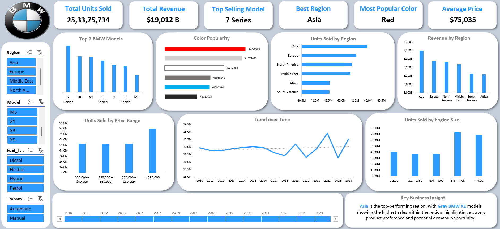

# BMW Sales Analysis Dashboard

An interactive BMW Sales Analysis Dashboard developed using Microsoft Excel to analyze sales performance, revenue, pricing, and customer preferences across different regions, models, and vehicle categories.

## Dashboard Preview

## Project Overview

This project focuses on analyzing BMW sales data to identify trends and patterns in sales performance. The dashboard provides an overview of key business metrics and allows users to explore the data through interactive filters.

## Tools & Technologies

- Microsoft Excel
- Power Query – Data Cleaning and Transformation
- Pivot Tables – Data Analysis and Aggregation
- Pivot Charts – Data Visualization
- Slicers – Interactive Filtering

## Key Features

- Interactive dashboard with dynamic slicers.
- Analysis of sales performance across different BMW models.
- Regional sales and revenue comparison.
- Analysis of vehicle colors, fuel types, and engine sizes.
- Average price and total sales performance metrics.
- Insights into popular models and customer preferences.

## Key Insights

- Identified the best-performing BMW models based on sales volume.
- Compared regional sales performance to identify leading markets.
- Analyzed popular vehicle colors and engine size categories.
- Explored pricing patterns across different BMW models.

## Project Files

- [BMW_analysis.xlsx](BMW_analysis.xlsx) – Excel workbook containing cleaned data, pivot table analysis, key insights, and the interactive dashboard.
- [bmw_dashboard.png](bmw_dashboard.png) – Dashboard preview image.

## Dataset

Source: [BMW Sales Data – Kaggle](https://www.kaggle.com/datasets/syrusdsouza/bmw-sales-data)
